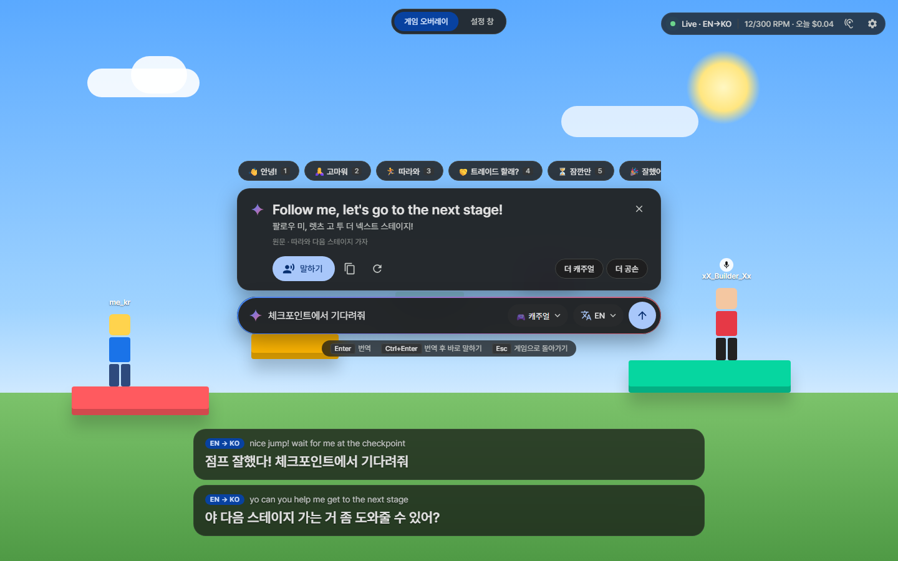

# Game Trans 🎮✨

> 게임 속 외국인 친구의 **목소리를 실시간 자막으로**, 내가 **하고 싶은 말은 바로 번역·음성 송출**까지.
> Google AI Studio의 `gemini-3.5-flash-lite`를 쓰는 Windows용 게임 번역 오버레이


---

## 무엇을 하나요?

| 기능 | 설명 |
| :--- | :--- |
| 🎧 **듣기 (Live Caption)** | 로블록스(게임) **프로세스 소리만** 캡처 → 말소리 구간만 잘라 Gemini로 전송 → 원문 + 번역 자막을 게임 화면 위에 표시 |
| ⌨️ **말하기 (Type & Read)** | 단축키로 Gemini 앱 스타일 입력 바 호출 → 한국어 입력 → 번역문 + **한글 발음**을 띄워줘서 직접 읽으면 됨 |
| 🔊 **보내기 (Voice Out)** | 번역문을 TTS로 만들어 **가상 마이크(VB-Cable)** 로 송출 → 상대방은 내 마이크 소리로 들음 |
| 💸 **사용량 관리** | 요청 수 / 예상 비용 실시간 표시, 한도(429) 도달 시 자동 대기·로컬 모드 전환 |

## 핵심 원칙

1. **게임을 건드리지 않는다** – 메모리 읽기, DLL 인젝션, DirectX 훅 일절 없음. 오버레이는 *독립된 투명 창*. (Hyperion/Byfron 안전 설계)
2. **포커스를 뺏지 않는다** – 평소엔 클릭이 게임으로 통과, 단축키를 누를 때만 입력 가능.
3. **한도를 아낀다** – VAD로 말소리만 전송, 문장 단위 요청, 토큰 버킷 레이트 리미터.
4. **Google스러운 UI** – Gemini 앱 / Material 3 디자인 언어 (다크, 둥근 pill, 그라디언트 스파클).

## 문서

- 📐 [설계 문서 (아키텍처·데이터 흐름·API 전략)](docs/DESIGN.md)
- 🎨 [UI / UX 가이드 (디자인 시스템·컴포넌트·인터랙션)](docs/UI_UX.md)
- 🗺️ [로드맵](docs/ROADMAP.md)
- 🖼️ [인터랙티브 UI 목업](docs/mockup/index.html) – 브라우저로 열어보세요



## 기술 스택

- **Python 3.12** + **PySide6 (Qt Quick / QML)** + **qasync** – 투명 오버레이 & Material 3 스타일 UI
- **google-genai** SDK – `gemini-3.5-flash-lite` (오디오 이해 + 번역, JSON 구조화 출력)
- **proc-tap** + **PyAudioWPatch** – WASAPI Process Loopback (`RobloxPlayerBeta.exe` 등 특정 프로세스 오디오 캡처) & 장치 루프백 폴백
- **Silero VAD** (`onnxruntime`, 선택) + **스펙트럼 VAD 폴백** – 말소리 구간 검출
- **edge-tts** + **miniaudio** (기본, 무료) / **Gemini TTS** / **Windows SAPI** – 3단계 TTS 폴백 체인
- **sounddevice** + **VB-Audio Virtual Cable** – 가상 마이크 출력 & 물리 마이크 덕킹 믹서
- **keyring** – API 키를 Windows 자격 증명 관리자에 안전하게 저장

## 요구 사항

- Windows 10 (빌드 20348+) 또는 Windows 11
- Google AI Studio API 키 ([발급](https://aistudio.google.com/apikey)) – 무료 티어로 시작, Google AI Pro 월 \$10 크레딧 연결 권장
- (선택, Silero ONNX VAD 사용 시) Microsoft Visual C++ 2015–2022 재배포 가능 패키지(x64) – 미설치 환경에서는 자동으로 내장 스펙트럼 VAD 폴백으로 동작
- (음성 송출 기능 사용 시) [VB-Audio Virtual Cable](https://vb-audio.com/Cable/)

## 실행 및 개발 환경

Phase 1–4 핵심 파이프라인과 QML 오버레이가 구현되어 있습니다. 상세 진행 상황은 [ROADMAP](docs/ROADMAP.md)을 참고하세요.

```powershell
python -m venv .venv
.venv\Scripts\activate
pip install -e .[dev]
python -m game_trans
```

> ⚠️ 이 프로젝트는 Google, Roblox와 무관한 개인 프로젝트입니다. Gemini는 Google LLC의 상표입니다.
