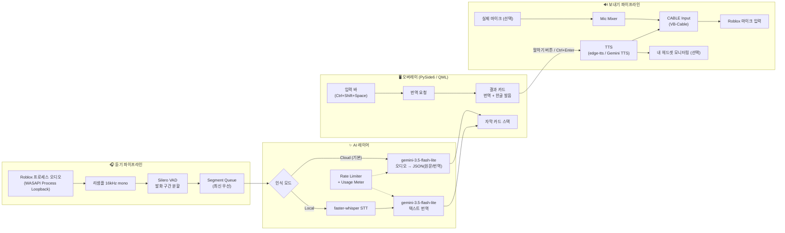

# 📐 Game Trans 설계 문서

> 버전 0.1 · 2026-11 · 구현 동기화

## 목차

1. [목표와 범위](#1-목표와-범위)
2. [전체 아키텍처](#2-전체-아키텍처)
3. [파이프라인 상세](#3-파이프라인-상세)
4. [Gemini API 사용 전략](#4-gemini-api-사용-전략)
5. [오버레이 창 & 안티치트 안전 설계](#5-오버레이-창--안티치트-안전-설계)
6. [편의 기능](#6-편의-기능)
7. [설정 & 데이터 저장](#7-설정--데이터-저장)
8. [에러 처리 & 폴백](#8-에러-처리--폴백)
9. [모듈 구조](#9-모듈-구조)
10. [성능 목표](#10-성능-목표)
11. [보안 & 프라이버시](#11-보안--프라이버시)

---

## 1. 목표와 범위

### 목표

| # | 사용자 시나리오 | 성공 기준 |
| :- | :--- | :--- |
| G1 | 상대가 영어로 말하면 1~2초 안에 한국어 자막이 뜬다 | 발화 종료 → 자막 표시 p50 ≤ 1.5초 |
| G2 | 단축키 → 한국어 입력 → 번역 + 한글 발음이 뜬다 | Enter → 결과 p50 ≤ 1.0초 |
| G3 | 버튼 한 번에 번역문이 내 마이크로 송출된다 | 클릭 → 송출 시작 ≤ 0.8초 (edge-tts) |
| G4 | 게임 조작이 절대 방해받지 않는다 | 평소 포커스/클릭 뺏김 0회 |
| G5 | Pro 혜택 \$10/월 안에서 넉넉히 쓴다 | 게임 1시간당 ≤ \$0.10 |

### 범위 밖 (Non-goals)

- 게임 메모리·패킷 접근, 게임 내 채팅 자동 입력(키 입력 자동화)
- 실시간 음성 변조(보이스 체인저), 다중 사용자 서버
- macOS / Linux (추후 검토)

---

## 2. 전체 아키텍처



### 스레드 / 동시성 모델

| 스레드 | 역할 |
| :--- | :--- |
| **UI 스레드 (Qt main)** | QML 렌더링, 사용자 입력. 블로킹 작업 금지 |
| **Audio Capture 스레드** | WASAPI 버퍼 폴링 → 링버퍼 (10ms 단위) |
| **VAD 스레드** | 링버퍼 → 32ms 프레임 → 발화 시작/종료 판정 → Segment 생성 |
| **asyncio 루프 (qasync)** | Gemini 요청, TTS 생성, 재시도·레이트 리밋. Qt 이벤트 루프와 통합 |
| **Audio Output 스레드** | sounddevice로 CABLE Input / 모니터 장치에 재생, 마이크 믹싱 |

컴포넌트 간 통신은 **이벤트 버스**(Qt Signal 기반) 하나로 통일한다.

```text
SegmentReady(segment) → TranscriptStarted(id) → TranscriptDone(id, result) / TranscriptFailed(id, err)
OutgoingRequested(text) → OutgoingDone(result) → SpeakRequested(text) → SpeakStarted / SpeakFinished
UsageUpdated(stats) · QuotaWarning(level) · ModeChanged(cloud|local)
```

---

## 3. 파이프라인 상세

### 3.1 오디오 캡처

| 방식 | 장점 | 단점 | 사용 |
| :--- | :--- | :--- | :--- |
| **Process Loopback** (`AUDIOCLIENT_ACTIVATION_TYPE_PROCESS_LOOPBACK`) | 게임 소리만 캡처, 디스코드/유튜브 제외 | Win10 20348+ 필요, COM 구현 필요 | **기본** |
| Device Loopback (PyAudioWPatch) | 구현 간단 | PC 전체 소리 섞임 | 폴백 |
| 특정 입력 장치 | 사용자가 라우팅한 장치 | 수동 설정 | 고급 |

- 대상 프로세스 자동 탐지: `RobloxPlayerBeta.exe` (설정에서 다른 게임 exe 추가 가능)
- PID는 프로세스 목록 조회로만 얻는다 (`OpenProcess`로 핸들 열지 않음).
- 구현: `proc-tap` (`ProcessAudioCapture`)으로 `ActivateAudioInterfaceAsync` Process Loopback을 직접 호출하고, 실패 시 `PyAudioWPatch` 장치 루프백으로 자동 폴백한다.

### 3.2 VAD & 세그먼트 분할

- **Silero VAD** (onnxruntime, CPU ~1ms/프레임) 기본, `onnxruntime`/모델 미가용 환경에서는 내장 **스펙트럼 VAD** (`_SpectralDetector`, 300–3400Hz + 적응형 노이즈 플로어) 로 자동 폴백한다.
- 파라미터 (설정에서 조정 가능):

| 파라미터 | 기본값 | 의미 |
| :--- | :--- | :--- |
| `speech_threshold` | 0.5 | 말소리 확률 임계값 |
| `min_speech_ms` | 300 | 이보다 짧으면 버림 (기침, 클릭음) |
| `silence_end_ms` | 450 | 이만큼 조용하면 문장 종료 |
| `max_segment_s` | 8 | 길게 말하면 강제로 끊어서 전송 (지연 방지) |
| `pre_roll_ms` | 200 | 발화 시작 직전 오디오 포함 (첫 음절 잘림 방지) |

- 게임 BGM이 커서 오탐이 많으면 → 설정의 **"BGM 억제"** 옵션: 간단한 밴드패스(300–3400Hz) 후 VAD 판정.

### 3.3 인식 + 번역 (Cloud 모드, 기본)

하나의 요청으로 **받아쓰기 + 언어 감지 + 번역**을 끝낸다.

- 입력: 세그먼트 WAV (16kHz mono, inline bytes) + 최근 자막 3개(문맥) + 용어집
- 출력: JSON 구조화 출력 (`response_schema`)

```json
{
  "is_speech": true,
  "source_lang": "en",
  "transcript": "yo can you help me get to the next stage",
  "translation": "야 다음 스테이지 가는 거 좀 도와줄 수 있어?",
  "confidence": 0.86
}
```

- `is_speech=false`(게임 효과음, 음악)면 자막을 띄우지 않는다.
- 목표 언어 == 감지 언어(예: 한국어 화자)면 번역 생략, 원문만 표시(옵션).

### 3.4 Local 모드 (한도 절약 / 오프라인 대비)

- `faster-whisper` (`small` int8, CPU / `large-v3-turbo` GPU) → 텍스트
- 텍스트만 Gemini로 번역 → 오디오 토큰 0, 요청당 수십 토큰
- 429 연속 발생 시 자동 전환 (설정으로 끌 수 있음)

### 3.5 말하기 (내 입력 → 번역)

1. `Ctrl+Shift+Space` → 입력 바 표시, **이때만** 창이 포커스를 가져감
2. 한국어 입력 → `Enter`
3. Gemini 요청 → 결과 카드:
   - **번역문** (크게) – 상대 언어 = 최근 자막에서 가장 많이 감지된 언어 (자동) 또는 고정
   - **한글 발음** – "커버 미, 아이 윌 고 레프트"
   - **대체 표현 칩 2개** – 더 캐주얼 / 더 공손
4. 액션
   - `Ctrl+Enter` / 🔊 **말하기** → TTS 송출
   - 📋 **복사** → 게임 채팅에 직접 붙여넣기용 (자동 입력은 하지 않음)
   - `Esc` → 닫고 게임으로 포커스 복귀

### 3.6 보내기 (TTS → 가상 마이크)

| 엔진 | 비용 | 지연 | 비고 |
| :--- | :--- | :--- | :--- |
| **edge-tts** (기본) | 무료 | ~0.5초 | 다국어 음성 다수, 비공식 엔드포인트라 차단 가능성 있음 → 폴백 필요 |
| Gemini TTS (`gemini-3.8-flash-lite-tts`) | 출력 100만 토큰당 \$6 (2027년~ \$12), 25토큰/초 | ~1초 | 자연스러움 최고, 무료 티어 한도 매우 낮음 |
| Windows SAPI / OneCore | 무료·오프라인 | 즉시 | 최종 폴백 |

- 출력 장치: `CABLE Input (VB-Audio Virtual Cable)` 자동 탐지, 없으면 설치 안내.
- **마이크 믹서 (Phase 3)**: 내 실제 마이크 + TTS를 섞어 CABLE로 보내서, Roblox 입력 장치를 CABLE로 고정한 채 평소처럼 말도 할 수 있게 함. TTS 재생 중엔 실제 마이크 자동 덕킹(-20dB).
- 같은 문장 재송출 시 캐시된 오디오 재사용 (비용 0).

---

## 4. Gemini API 사용 전략

### 4.1 모델 & 설정

| 용도 | 모델 | 설정 |
| :--- | :--- | :--- |
| 듣기 (오디오→번역) | `gemini-3.5-flash-lite` | `thinking_level=minimal`, JSON schema, `temperature=0.2` |
| 말하기 (텍스트 번역) | `gemini-3.5-flash-lite` | `thinking_level=minimal`, JSON schema |
| TTS (선택) | `gemini-3.8-flash-lite-tts` | voice 선택 |

모델 ID는 설정 파일에서 바꿀 수 있게 하드코딩하지 않는다.

### 4.2 시스템 프롬프트 (요지)

```text
You are a real-time interpreter for online multiplayer games (Roblox).
- Transcribe the audio verbatim, detect language, translate into {target_lang}.
- Keep gamer slang natural (e.g. "gg", "noob", "obby", "AFK"); do not over-formalize.
- Never translate usernames or terms in the glossary: {glossary}.
- If the audio is music, sound effects, or unintelligible, set is_speech=false.
- Output JSON only, matching the schema.
Recent context: {last_3_subtitles}
```

### 4.3 한도 & 비용 관리

- **토큰 버킷 레이트 리미터**: 설정값 `rpm_limit` (무료 티어 기본 10, Tier 1 기본 300)
- **큐 정책**: 실시간성이 중요하므로 큐가 3개를 넘으면 **가장 오래된 세그먼트를 버림**(“최신 우선”)
- **짧은 세그먼트 병합**: 1초 미만 세그먼트가 연속으로 오면 합쳐서 1회 요청
- **Usage Meter**: 응답의 `usage_metadata`로 토큰 집계 → 예상 비용 계산 (단가는 설정 파일)
  - 입력 \$0.30 / 출력 \$2.50 per 1M tokens (gemini-3.5-flash-lite, 유료 단가 기준)
  - 오디오 입력 = 32 tokens/초
- **예산 가드**: 월 예상 비용이 `monthly_budget_usd`(기본 \$9)의 80% → 경고, 100% → 로컬 모드 전환

### 4.4 인증

- **API 키 방식** (기본): AI Studio에서 발급한 키를 `keyring`으로 Windows 자격 증명 관리자에 저장
- OAuth(Desktop App)는 배포용으로 Phase 4에서 검토. 어느 방식이든 **AI Studio/Cloud 프로젝트 한도**를 따르며, Gemini 앱 구독 한도와는 별개임을 온보딩에서 안내.

---

## 5. 오버레이 창 & 안티치트 안전 설계

### 5.1 창 구성

| 창 | 플래그 | 동작 |
| :--- | :--- | :--- |
| **Caption Overlay** | Frameless · StaysOnTop · Tool · TranslucentBackground + `WS_EX_TRANSPARENT \| WS_EX_LAYERED \| WS_EX_NOACTIVATE` | 항상 클릭 통과, 포커스 절대 안 가져감 |
| **Status Pill** | 위와 동일 (편집 모드에서만 드래그 가능) | 듣기 상태 / 사용량 미니 표시 |
| **Input Bar** | Frameless · StaysOnTop · 포커스 가능 | 단축키로 열 때만 활성화, `Esc`/전송 후 자동 숨김 |
| **Settings Window** | 일반 창 (Mica 배경) | 트레이 메뉴에서 열기 |

- **편집 모드** (`Ctrl+Shift+E`): 클릭 통과 해제 → 자막 위치·크기 드래그 → 다시 누르면 고정
- Roblox는 **테두리 없는 창/창 모드**에서 사용 권장 (전용 전체화면에서는 오버레이가 가려질 수 있음)

### 5.2 안전 체크리스트 (코드 리뷰 필수 항목)

- [ ] 게임 프로세스에 `OpenProcess` / `ReadProcessMemory` / DLL 인젝션 **없음**
- [ ] DirectX/Vulkan 훅, 게임 창에 직접 그리기 **없음**
- [ ] 게임 창으로 키 입력 자동 전송(SendInput) **없음** – 채팅은 클립보드 복사만
- [ ] 전역 단축키는 저수준 키보드 훅이 아닌 **`RegisterHotKey`** 사용
- [ ] 오디오는 OS 오디오 API(WASAPI)로만 수집

> 음성 송출 기능은 각 게임의 보이스챗 규정(소음·스팸 금지 등)을 지키며 사용해야 한다.

---

## 6. 편의 기능

| 분류 | 기능 | 우선순위 |
| :--- | :--- | :---: |
| **자막** | 원문/번역 동시 표시, 원문 숨기기 토글 | P1 |
| | 자막 자동 사라짐 (기본 6초), 최대 3줄 스택 | P1 |
| | 언어 칩 (`EN → KO`), 신뢰도 낮으면 흐리게 표시 | P2 |
| | **자막 히스토리 패널** – 지난 대화 스크롤, 클릭하면 복사 | P2 |
| **말하기** | 한글 발음 표기, 대체 표현(캐주얼/공손) | P1 |
| | **빠른 문구(Quick Phrases)** – "따라와", "고마워", "트레이드?" 원클릭 송출, 사용자 편집 | P2 |
| | 상대 언어 자동 추적 (최근 감지 언어) | P1 |
| | 말투 프리셋: 게이머 캐주얼 / 기본 / 공손 | P2 |
| **음성** | TTS 음성·속도 선택, 내 헤드셋 모니터링 | P2 |
| | 마이크 믹서 + 덕킹 | P3 |
| **AI** | 용어집 (번역 금지어, 게임 용어 사전) | P2 |
| | Cloud ↔ Local 모드 전환, 429 자동 폴백 | P2 |
| **관리** | 사용량/비용 미터, 월 예산 가드 | P1 |
| | 세션 대화 기록 저장 (선택, 로컬 파일) | P3 |
| **편의** | 시스템 트레이, Windows 시작 시 자동 실행, 게임 실행 감지 시 자동 듣기 | P2 |
| | 온보딩 마법사 (API 키 → 오디오 → VB-Cable → 단축키 테스트) | P1 |
| | 다중 모니터, 위치 프리셋 (하단 중앙/좌하단/우상단) | P2 |

### 기본 단축키 (모두 변경 가능)

| 단축키 | 동작 |
| :--- | :--- |
| `Ctrl+Shift+Space` | 입력 바 열기/닫기 (Gemini 앱 `Alt+Space`와 충돌 방지) |
| `Enter` / `Ctrl+Enter` | 번역 / 번역 후 바로 음성 송출 |
| `Ctrl+Shift+S` | 마지막 번역문 다시 송출 |
| `Ctrl+Shift+L` | 듣기(자막) 켜기/끄기 |
| `Ctrl+Shift+H` | 자막 히스토리 패널 |
| `Ctrl+Shift+E` | 오버레이 편집 모드 |
| `Ctrl+Shift+1~9` | 빠른 문구 1~9 송출 |

---

## 7. 설정 & 데이터 저장

- 위치: `%APPDATA%\GameTrans\`
  - `config.toml` – 사용자 설정 ([예시](../config.example.toml))
  - `phrases.json`, `glossary.json`
  - `usage.sqlite` – 일별 요청/토큰/비용
  - `logs\` – 회전 로그 (API 키·오디오 내용 기록 금지)
- API 키: **파일에 저장하지 않음** → `keyring` (Windows Credential Manager)

---

## 8. 에러 처리 & 폴백

| 상황 | 동작 | UI 표시 |
| :--- | :--- | :--- |
| `429 RESOURCE_EXHAUSTED` | 지수 백오프(1→2→4초, 최대 3회), 큐 최신 우선 유지 | 상태 pill 주황 "한도 대기 중" |
| 429가 1분 내 5회+ | Local 모드 자동 전환 (설정 시) | 토스트 "로컬 모드로 전환했어요" |
| 네트워크 끊김 | 요청 보류, 30초 후 재시도 | 상태 pill 회색 "오프라인" |
| 잘못된 API 키 (401/403) | 듣기 중지 | 설정 창 열고 키 필드 강조 |
| Roblox 미실행 | 대기, 실행 감지 시 자동 시작 | "게임을 기다리는 중…" |
| VB-Cable 없음 | 말하기 버튼 비활성 | 설치 안내 링크 |
| edge-tts 실패 | Gemini TTS → SAPI 순으로 폴백 | 없음 (자동) |

---

## 9. 모듈 구조

```text
src/game_trans/
├── __main__.py           # 진입점
├── app.py                # 앱 부트스트랩: Qt + qasync + 트레이 + 전역 단축키
├── config.py             # 설정 모델 (TOML ↔ dataclass) & 문구/용어집 JSON
├── events.py             # 파이프라인 이벤트/데이터 모델 (Mode, Segment, Caption, OutgoingTranslation)
├── audio/
│   ├── capture.py        # ProcessLoopbackCapture (proctap) / DeviceLoopbackCapture (PyAudioWPatch)
│   ├── vad.py            # Silero ONNX + 스펙트럼 폴백 VAD 세그먼터
│   └── output.py         # 가상 마이크 출력 & 마이크 덕킹 믹서
├── ai/
│   ├── gemini_client.py  # 듣기/말하기 요청, 구조화 출력
│   ├── prompts.py        # 시스템 프롬프트 & JSON 스키마
│   ├── rate_limiter.py   # 토큰 버킷
│   └── usage.py          # 토큰·비용 집계 & SQLite 영속화
├── stt/
│   └── local_whisper.py  # faster-whisper (Local 모드)
├── tts/
│   ├── base.py           # TTS 인터페이스, LRU 캐시 & 폴백 체인
│   ├── edge.py           # edge-tts + miniaudio 디코딩
│   ├── gemini_tts.py     # Gemini TTS
│   └── sapi.py           # Windows System.Speech 오프라인 폴백
├── platform/
│   ├── hotkeys.py        # RegisterHotKey 래퍼
│   ├── window.py         # 클릭 통과/NOACTIVATE 창 스타일
│   └── secrets.py        # keyring 래퍼
└── ui/
    ├── bridge.py         # Python ↔ QML 바인딩 (QObject)
    └── qml/
        ├── qmldir          # QML 모듈 정의 (Theme 싱글톤)
        ├── Theme.qml       # 디자인 토큰
        ├── Sparkle.qml     # AI 그라디언트 스파클
        ├── ShimmerBar.qml  # 로딩 쉬머
        ├── M3Card.qml      # Material 3 카드
        ├── M3Switch.qml    # Material 3 스위치
        ├── StatusPill.qml  # 상단 상태 배지
        ├── CaptionOverlay.qml # 실시간 자막 스택
        ├── InputBar.qml    # 말하기 플로팅 입력 바 + 결과 카드
        ├── HistoryWindow.qml  # 자막 기록 패널
        └── SettingsWindow.qml # 온보딩 & 설정 창
```

---

## 10. 성능 목표

| 지표 | 목표 |
| :--- | :--- |
| 발화 종료 → 자막 (Cloud) | p50 ≤ 1.5초, p95 ≤ 2.5초 |
| 입력 Enter → 번역 결과 | p50 ≤ 1.0초 |
| 유휴 CPU (듣기 중) | ≤ 3% (VAD 포함) |
| 메모리 | ≤ 250MB (Local 모드 제외) |
| 게임 FPS 영향 | 측정 불가 수준 (오버레이는 이벤트 시에만 리페인트) |

---

## 11. 보안 & 프라이버시

- API 키는 Credential Manager에만 저장, 로그·크래시 리포트에서 마스킹
- 오디오는 메모리에서만 처리, 디스크 저장 안 함 (디버그 옵션 제외)
- **무료 티어 고지**: 무료 티어 사용 시 입력 데이터가 Google 서비스 개선에 활용될 수 있음을 온보딩에서 안내 → 유료(크레딧 연결) 프로젝트 권장
- 대화 기록 저장은 기본 꺼짐
