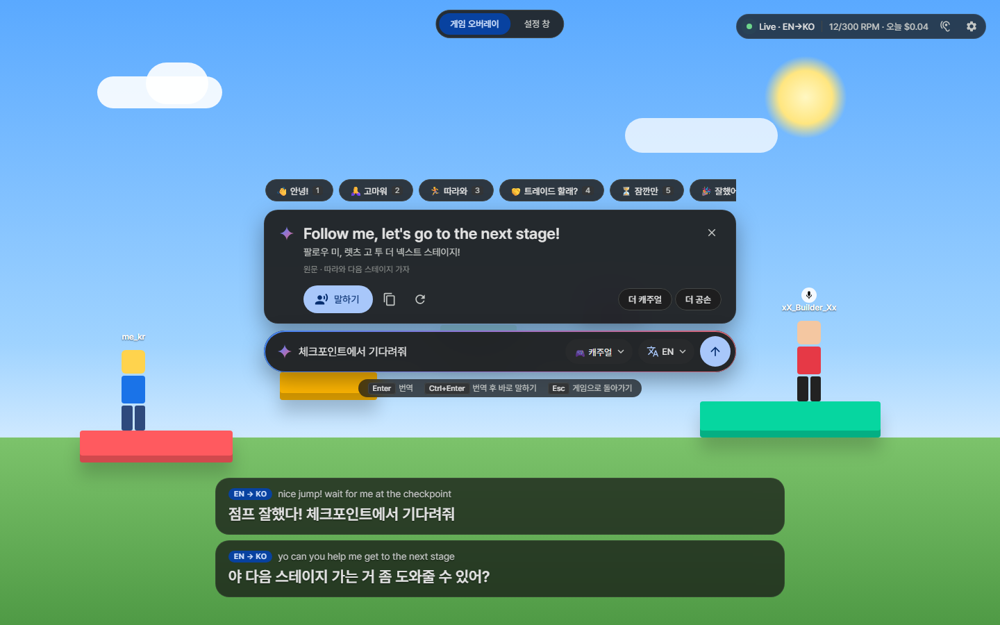
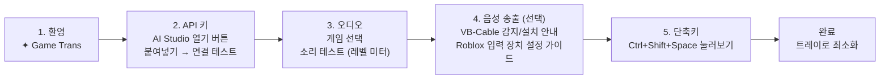
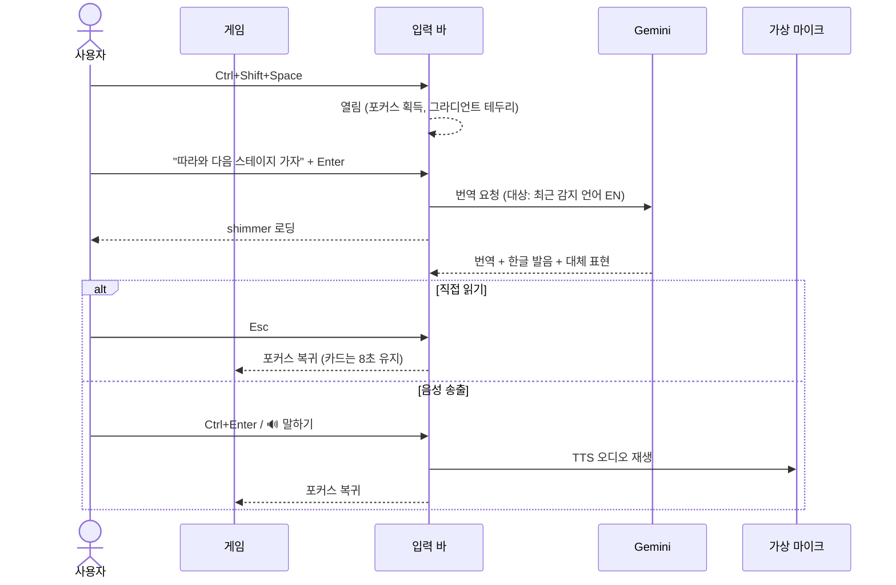

# 🎨 Game Trans UI / UX 가이드

> Gemini 앱(데스크톱 `Alt+Space` 오버레이, 웹 채팅)과 Google **Material 3** 디자인 언어를 참고한 디자인 시스템.
> 목표: *“게임 위에 떠 있지만 게임을 가리지 않는, Google스럽게 차분한 UI”*



인터랙티브 목업: [`docs/mockup/index.html`](mockup/index.html) (브라우저로 열기)

---

## 1. 디자인 원칙

| 원칙 | 의미 | 적용 |
| :--- | :--- | :--- |
| **Glanceable** | 0.5초 안에 읽힌다 | 번역문 크게·고대비, 원문은 작고 흐리게 |
| **Out of the way** | 게임을 가리지 않는다 | 반투명 카드, 자동 사라짐, 클릭 통과, 하단 1/4 영역만 사용 |
| **Calm AI** | AI가 일하는 중임을 조용히 보여준다 | Gemini 스타일 그라디언트 shimmer, 깜빡임/팝업 최소화 |
| **Keyboard first** | 마우스 없이 전부 가능 | 모든 동작에 단축키, 입력 바는 Spotlight처럼 |
| **Forgiving** | 실패해도 게임 흐름을 안 끊는다 | 에러는 상태 pill 색으로만, 모달 금지 |

---

## 2. 디자인 토큰

### 2.1 색상 (Dark – 기본)

Gemini 앱 다크 테마 톤을 기준으로 한 Material 3 색 역할.

| 토큰 | 값 | 용도 |
| :--- | :--- | :--- |
| `surface` | `#131314` | 설정 창 배경 |
| `surface-container` | `#1E1F20` | 카드, 입력 바 |
| `surface-container-high` | `#282A2C` | 호버, 칩 배경 |
| `surface-container-highest` | `#333537` | 눌림, 선택 |
| `overlay-scrim` | `rgba(19,19,20,0.72)` + blur 20px | 게임 위 자막 카드 |
| `outline` | `#444746` | 구분선, 테두리 |
| `on-surface` | `#E3E3E3` | 본문 텍스트 (번역문) |
| `on-surface-variant` | `#C4C7C5` | 보조 텍스트 (원문, 라벨) |
| `primary` | `#A8C7FA` | 주요 버튼, 포커스 링, 활성 스위치 |
| `on-primary` | `#062E6F` | primary 위 텍스트 |
| `primary-container` | `#0842A0` | 선택된 칩, 강조 배경 |
| `success` | `#6DD58C` | 듣는 중 (Live 점) |
| `warning` | `#FFB870` | 한도 대기 |
| `error` | `#F2B8B5` | 오류 |

**AI 그라디언트 (스파클 / 로딩 / 강조)**

```css
--ai-gradient: linear-gradient(90deg, #4285F4 0%, #9B72CB 50%, #D96570 100%);
```

- 사용처: 스파클 아이콘, 번역 중 shimmer, 입력 바 포커스 테두리, 온보딩 히어로 텍스트
- **남용 금지** – 화면당 1곳만

### 2.2 타이포그래피

| 역할 | 폰트 | 크기 / 굵기 / 행간 | 용도 |
| :--- | :--- | :--- | :--- |
| Display | Google Sans Flex → Pretendard | 32 / 500 / 40 | 온보딩 제목 |
| Title | 〃 | 20 / 500 / 28 | 설정 섹션 제목 |
| **Caption-Translation** | Pretendard → Noto Sans KR | **22 / 600 / 30** (조절 16–36) | 자막 번역문 |
| Caption-Original | Google Sans Flex → Pretendard | 14 / 400 / 20 | 자막 원문 |
| Body | 〃 | 15 / 400 / 22 | 일반 텍스트 |
| Label | 〃 | 13 / 500 / 18 | 버튼, 칩 |

- 폰트는 오픈 라이선스(OFL) 확인 후 앱에 번들. 한글은 **Pretendard** 우선.
- 게임 위 텍스트에는 가독성용 미세 그림자 `0 1px 2px rgba(0,0,0,.6)`.

### 2.3 모양 (Shape)

| 요소 | 반경 |
| :--- | :--- |
| 입력 바, 버튼, 칩, 상태 pill | **Full (999px)** – Gemini 입력창 같은 pill |
| 자막 카드, 결과 카드 | 20px |
| 설정 카드 | 16px |
| 아이콘 버튼 | 원형 40×40 (터치 영역 48) |

### 2.4 모션

| 토큰 | 값 | 용도 |
| :--- | :--- | :--- |
| `emphasized` | `cubic-bezier(0.2, 0, 0, 1)` 400ms | 입력 바 열림, 카드 등장 |
| `standard` | `cubic-bezier(0.2, 0, 0, 1)` 200ms | 호버, 상태 변경 |
| `exit` | `cubic-bezier(0.3, 0, 1, 1)` 150ms | 사라짐 |
| `shimmer` | 1.6s linear infinite | 번역 중 그라디언트 흐름 |

- 자막 등장: 아래서 8px 위로 + fade in. 사라짐: fade out만.
- 설정에서 **“모션 줄이기”** 켜면 모든 이동 애니메이션 제거 (fade만).

### 2.5 아이콘

**Material Symbols Rounded** (Apache 2.0) · weight 400 · fill 0 (활성 시 1)

| 기능 | 아이콘 |
| :--- | :--- |
| 듣기 | `hearing` / `hearing_disabled` |
| 말하기(송출) | `record_voice_over` |
| 보내기 | `arrow_upward` (Gemini 전송 버튼처럼 원형) |
| 복사 | `content_copy` |
| 다시 번역 | `refresh` |
| 설정 | `settings` |
| AI | 커스텀 4각 스파클 SVG (그라디언트 채움) |

---

## 3. 화면 & 컴포넌트

### 3.1 화면 레이아웃 (게임 위)

```text
┌──────────────────────────────────────────────────────────────┐
│ ● Live · EN→KO · 12/300 RPM · $0.04          ← Status Pill    │
│                                                (우상단)        │
│                                                              │
│                      (게임 화면)                               │
│                                                              │
│         ╭──────────────────────────────────────────╮         │
│         │ ✦ 따라와, 다음 스테이지로 가자!          ┃ ← 결과   │
│         │   팔로우 미, 렛츠 고 투 더 넥스트 스테이지 │   카드    │
│         │ [🔊 말하기] [📋] [↻]   ( 캐주얼 ) ( 공손 )  │         │
│         ╰──────────────────────────────────────────╯         │
│         ╭──────────────────────────────────────────╮         │
│         │ ✦  하고 싶은 말을 입력하세요…  [EN▾] (↑) │ ← 입력 바 │
│         ╰──────────────────────────────────────────╯         │
│                                                              │
│      ┌ EN ─────────────────────────────────────────┐         │
│      │ yo can you help me get to the next stage    │ ← 자막   │
│      │ 야 다음 스테이지 가는 거 좀 도와줄 수 있어?  │   (하단)  │
│      └─────────────────────────────────────────────┘         │
└──────────────────────────────────────────────────────────────┘
```

### 3.2 자막 카드 (Caption Card)

| 상태 | 표현 |
| :--- | :--- |
| **듣는 중** (VAD 발화 감지) | 카드 자리에 작은 파형 3개 점 애니메이션 |
| **번역 중** | 원문 자리에 AI 그라디언트 shimmer 바 2줄 (Gemini 로딩과 동일한 느낌) |
| **완료** | 언어 칩 + 원문(작게, `on-surface-variant`) + 번역문(크게, `on-surface`) |
| 신뢰도 < 0.5 | 번역문 opacity 70% + 끝에 `?` 아이콘 |
| 사라짐 | 6초 후 fade out (설정), 새 자막이 오면 위로 밀림, 최대 3개 |

### 3.3 입력 바 (Input Bar) – Gemini 데스크톱 `Alt+Space` 스타일

- 폭 640px, 높이 56px, pill, `surface-container` + 1px `outline`
- 포커스 시 테두리가 **AI 그라디언트**로 바뀜
- 구성: `✦ 스파클` · 입력 필드 (placeholder “하고 싶은 말을 입력하세요…”) · `대상 언어 칩 [EN ▾]` · `말투 칩 [🎮 캐주얼 ▾]` · 원형 전송 버튼
- 전송 버튼: 입력이 비면 `surface-container-high` 비활성, 입력이 있으면 `primary` 채움
- `↑` 키: 이전 입력 히스토리

### 3.4 결과 카드 (Translation Result)

- 번역문 22px/600 · 한글 발음 14px `on-surface-variant` · 원문 접기
- 액션 행:
  - **Filled 버튼** `🔊 말하기` (`primary` 배경, pill) – 주 액션은 하나만
  - **Icon 버튼** `📋 복사`, `↻ 다시 번역`
  - **Suggestion 칩** `더 캐주얼` `더 공손` – Gemini의 추천 칩처럼 outline pill
- 송출 중: `말하기` 버튼이 파형 애니메이션 + “송출 중…”으로 변하고 다시 누르면 중지

### 3.5 상태 Pill (Status Pill)

| 상태 | 점 색 | 텍스트 예 |
| :--- | :--- | :--- |
| 듣는 중 | `success` (숨쉬기 애니메이션) | `● Live · EN→KO` |
| 일시정지 | `outline` | `일시정지 · Ctrl+Shift+L` |
| 한도 대기 | `warning` | `한도 대기 3초` |
| 로컬 모드 | `primary` | `Local · faster-whisper` |
| 오류 | `error` | `API 키 확인 필요` |

- 오른쪽에 사용량 미니 표시: `12/300 RPM · 오늘 $0.04` (설정에서 숨김 가능)

### 3.6 빠른 문구 (Quick Phrases)

- 입력 바 위에 가로 스크롤 칩 행: `👋 안녕` `🙏 고마워` `🏃 따라와` `🤝 트레이드?` `⏳ 잠깐만`
- 칩 클릭 = 번역 + 즉시 송출, 숫자키 단축키 표시(`1`~`9`)

### 3.7 설정 창 (Settings)

- Material 3 **Navigation Rail** (좌측) + 콘텐츠 영역, 배경 `surface`
- 섹션: `일반` · `오디오` · `AI & 번역` · `오버레이` · `음성 송출` · `단축키` · `빠른 문구` · `사용량` · `정보`
- 각 항목은 `surface-container` 카드 안에 **리스트 아이템 + M3 Switch / Dropdown / Slider**
- **사용량 섹션**: 이번 달 예상 비용 progress bar (AI 그라디언트), 일별 막대 차트, 월 예산 입력
- **오버레이 섹션**: 실시간 미리보기 (글자 크기·투명도·위치 바꾸면 즉시 반영)

### 3.8 온보딩 (첫 실행)



- 각 단계는 큰 카드 1장, 하단에 `이전` (text 버튼) / `다음` (filled 버튼)
- 상단 진행 표시: 5개 점 (현재 단계 = primary 길쭉한 pill)

---

## 4. 인터랙션 흐름

### 말하기 플로우



---

## 5. 접근성 & 사용자 조절

- 자막 글자 크기 16–36px, 카드 투명도 40–95%, 자막 유지 시간 3–15초
- 텍스트 대비 WCAG AA 이상 (`#E3E3E3` on `rgba(19,19,20,.72)` 위 게임 화면 → 그림자 보정)
- 라이트 테마는 설정 창에만 제공 (오버레이는 항상 다크)
- 색만으로 상태를 구분하지 않음 → 상태 pill에 항상 텍스트 병기

---

## 6. 브랜딩 주의

- Gemini/Google **로고·워드마크는 사용하지 않는다**. 스파클은 자체 제작 SVG.
- 앱 이름은 “Game Trans”, “Powered by Gemini API” 정도의 텍스트 표기만.
